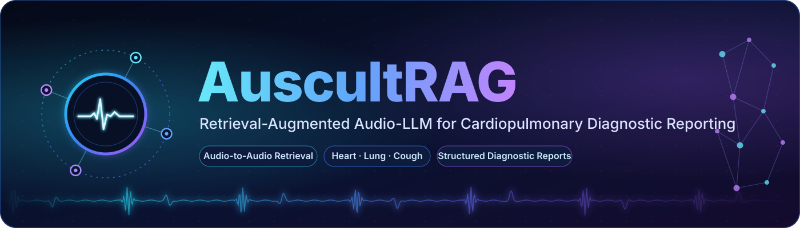

<p align="center">
  
</p>

<p align="center">
  <a href="#citation"></a>
  
  
  
  
  <a href="LICENSE"></a>
  <br>
  
  
  
</p>

<p align="center">
  <b>Give any audio LLM an acoustic memory.</b> AuscultRAG retrieves acoustically similar heart, lung and cough recordings from a
  patient-disjoint case library and uses their expert annotations as evidence, so that general-purpose audio LLMs can write
  structured diagnostic reports from the sound, without any fine-tuning.
</p>

<p align="center">
  <a href="#overview"><b>Overview</b></a> &nbsp;·&nbsp;
  <a href="#highlights"><b>Highlights</b></a> &nbsp;·&nbsp;
  <a href="#installation"><b>Installation</b></a> &nbsp;·&nbsp;
  <a href="#running-the-pipeline"><b>Pipeline</b></a> &nbsp;·&nbsp;
  <a href="#re-scoring-the-released-outputs-no-api-needed"><b>Re-score released outputs</b></a> &nbsp;·&nbsp;
  <a href="#citation"><b>Citation</b></a> &nbsp;·&nbsp;
  <a href="#license"><b>License</b></a>
</p>

---

## Highlights

- **Training-free.** No model is fine-tuned. Retrieval runs on frozen CLAP embeddings, and the case library can grow by appending new recordings.
- **Audio-to-audio retrieval.** Unit-level neighbours (cardiac cycles, respiratory events, cough bursts) are aggregated into provenance-filtered, patient-diverse cases.
- **Clinically structured output.** Models write Findings, an Impression and expert-defined report fields, scored field by field against the corpora's expert annotations.
- **Strict evaluation.** Patient-disjoint folds, every hyper-parameter selected on a separate development fold, and patient-level (paired) bootstrap CIs.
- **Broad comparison.** Proprietary and open audio LLMs, medical LLMs (CaReAQA, MedGemma), text-only controls, k-NN and supervised specialist probes (OPERA-CT, HeAR, CLAP).
- **Stress tests.** Evidence-relevance controls (random and far neighbours), text-based retrieval, cross-dataset retrieval and query-side noise and codec perturbations.
- **Re-scorable.** Every prompt (including the retrieved evidence) and every raw model response is released, so all LLM report scores can be recomputed without calling any API.

## Overview

General-purpose audio LLMs can hear a stethoscope recording, but they rarely know what a murmur grade or a crackle should sound like. **AuscultRAG** gives them that knowledge **without any training**. For a query recording it:

1. **Segments** the recording into auscultation units: cardiac cycles, respiratory cycles or events, and cough bursts.
2. **Retrieves** acoustically similar cases from a patient-disjoint case library by **audio-to-audio** similarity. Unit-level neighbours are aggregated into cases, filtered by provenance and diversified across patients.
3. **Grounds** the LLM in those cases: it writes a structured diagnostic report (Findings, Impression and expert-defined report fields) with the cases' expert annotations as evidence.

```
            ┌──────────────┐   units   ┌───────────────────┐  top-k cases (other patients)
 query ───► │ segmentation │ ────────► │ CLAP unit encoder │ ─────────────┐
 audio      └──────────────┘           └───────────────────┘              ▼
   │                                       case library (KB)  ┌─────────────────────────┐
   │                                     patient-disjoint ──► │ provenance filter +     │
   │                                                          │ case aggregation (top-m)│
   │                                                          │ + patient diversity     │
   │                                                          └───────────┬─────────────┘
   │                       evidence: similar cases + expert annotations   │
   └─────────────────────────────────►  Audio LLM  ◄──────────────────────┘
                                            │
                                            ▼
                         Findings · Impression · REPORT {field: value, ...}
```

**What this repository contains**
- The full pipeline, from raw-corpus acquisition through segmentation, embedding, retrieval and LLM inference to scoring.
- All baselines and controls used in the paper:
  - k-NN vote, text-only models, random and far evidence, text-based retrieval;
  - supervised specialist probes (OPERA-CT, HeAR, CLAP), the CaReAQA and MedGemma baselines;
  - the two-step protocol for open audio LLMs;
  - query-side robustness perturbations and cross-dataset retrieval.
- **Raw experimental outputs**: every queue (the exact prompts and evidence), every model response, and the per-run score files, under `artifacts_committed/`. All tables can be re-scored without re-querying any model.

---

## Contents

- [Highlights](#highlights)
- [Overview](#overview)
- [Repository layout](#repository-layout)
- [Installation](#installation)
- [Data](#data)
- [Running the pipeline](#running-the-pipeline)
  - [Step 1 – Manifest and patient-disjoint splits](#step-1--manifest-and-patient-disjoint-splits)
  - [Step 2 – Segmentation and embedding](#step-2--segmentation-and-embedding)
  - [Step 3 – Retrieval (dev selection → test)](#step-3--retrieval-dev-selection--test)
  - [Step 4 – Structured-report evaluation](#step-4--structured-report-evaluation)
  - [Step 5 – Baselines, controls and analyses](#step-5--baselines-controls-and-analyses)
- [Re-scoring the released outputs (no API needed)](#re-scoring-the-released-outputs-no-api-needed)
- [Evaluation protocol in one paragraph](#evaluation-protocol-in-one-paragraph)
- [Compute and cost](#compute-and-cost)
- [Citation](#citation)
- [License](#license)

---

## Repository layout

```
.
├── auscultrag/                 # library code
│   ├── config.py               #   paths (raw_data/, artifacts/), seeds, label spaces, .env loader
│   ├── corpora/                #   one builder per corpus -> unified manifest rows
│   ├── data/                   #   schema, audio probing, de-duplication, patient-level splits
│   ├── segmentation/           #   cardiac-cycle / respiratory-cycle / cough-burst units
│   ├── retrieval/              #   UnitIndex, case retrieval (provenance filter, top-m, diversity)
│   ├── llm/                    #   prompts (v3 structured report) and report-field definitions
│   ├── eval/                   #   metrics (macro-F1, bootstrap)
│   └── robustness.py           #   query-side perturbations (babble, ambience, noise, codec, ...)
├── configs/tasks.yaml          # the 8 evaluation tasks and their label spaces
├── scripts/                    # one entry point per pipeline stage (see below)
│   └── acquire/                #   download scripts for the public corpora (+ checksums)
├── envs/gpu/                   # separate environment for open-weight LLMs (transformers 5.x)
├── slurm/                      # example SLURM job (GPU embedding)
├── tests/                      # unit tests (retrieval engine, split invariants)
├── assets/banner.svg           # README banner
├── artifacts_committed/        # released raw results: queues, responses, per-run scores, splits
├── pyproject.toml / uv.lock    # pinned main environment
├── LICENSE                     # MIT
└── README.md
```

Large data stays **outside git** in two directories, created by you as folders or symlinks:

| Directory | Content | Override with |
|---|---|---|
| `raw_data/` | downloaded corpora, Hugging Face cache, external repos | `AUSCULTRAG_RAW` |
| `artifacts/` | manifest, units, embeddings, retrieval results, LLM queues and responses | `AUSCULTRAG_ARTIFACTS` |

---

## Installation

We use [uv](https://docs.astral.sh/uv/) with a lock file. Packages are pinned to versions published before 2026-09-25.

```bash
# main environment (data, retrieval, API models, scoring)
uv sync                      # creates .venv from uv.lock
uv sync --group opera        # + OPERA encoder dependencies
uv sync --group dev          # + pytest

# sanity check
uv run pytest -q tests
```

**Open-weight LLMs** (Qwen2-Audio, Audio Flamingo 3, MedGemma, CaReAQA, Qwen2.5 extractor) need a newer `transformers`, so they use a separate environment. This keeps the main environment, and therefore the CLAP embeddings, unchanged:

```bash
UV_PROJECT_ENVIRONMENT=raw_data/envs/gpu uv sync --project envs/gpu
export GPU_PYTHON=raw_data/envs/gpu/bin/python
```

**External encoder code** (pinned commits), cloned into `raw_data/external/`:

```bash
git clone https://github.com/evelyn0414/OPERA      raw_data/external/OPERA
git -C raw_data/external/OPERA checkout 3622310e667afb8aa40169050b4dd45de75946a2
git clone https://github.com/Google-Health/hear     raw_data/external/hear
git -C raw_data/external/hear  checkout 36bbb90879545a2f1106668048b1a12a61ff2a0d
```

**Credentials.** Create a git-ignored `.env` in the repository root. Existing environment variables take precedence over it.

```bash
OPENAI_API_KEY=...      # gpt-audio-*, gpt-5.4
GEMINI_API_KEY=...      # gemini-* (Google AI Studio)
HF_TOKEN=...            # gated models: google/hear-pytorch, google/medgemma-4b-it, google/medgemma-27b-text-it
```

Accept the licences of the gated Hugging Face models with the account that owns `HF_TOKEN`.

---

## Data

Six public corpora and eight tasks. Every corpus keeps its own clinical label space.

| Corpus | Sound | Task(s) | Primary label space | Download |
|---|---|---|---|---|
| CirCor DigiScope | heart | `circor_outcome` | Normal / Abnormal | `scripts/acquire/circor.sh` |
| ICBHI 2017 | lung | `icbhi_adventitious`, `icbhi_chronic` | Normal/CAS/DAS/CAS&DAS; Chronic/Non-chronic/Healthy | `scripts/acquire/icbhi.sh` |
| SPRSound | lung (paediatric) | `sprsound_adventitious` | Normal/CAS/DAS/CAS&DAS | `scripts/acquire/sprsound.sh` |
| KAUH | lung | `kauh_adventitious` | Normal/CAS/DAS | `scripts/acquire/kauh.sh` |
| TBScreen | cough | `tbscreen_cough` | TB / non-TB | `python scripts/acquire/tbscreen.py` |
| Coswara | cough, breathing | `coswara_cough`, `coswara_respiratory` | 8 COVID-19 status classes | `scripts/acquire/coswara.sh` |

```bash
mkdir -p raw_data artifacts
for c in circor icbhi sprsound kauh coswara; do bash scripts/acquire/$c.sh; done
uv run python scripts/acquire/tbscreen.py --workers 8      # HTTP range requests, ~2.5 GB of a 395 GB archive
```

The download scripts pin upstream versions and verify checksums (`scripts/acquire/checksums/`). Please respect each dataset's licence.

---

## Running the pipeline

Every stage is a single script and is **resumable**: re-running it continues where it stopped. Outputs carry a config hash, git commit and seed. Commands below assume the repository root and `uv run` (or an activated `.venv`).

### Step 1 – Manifest and patient-disjoint splits

```bash
python scripts/build_manifest.py --corpora circor,icbhi,sprsound,kauh,tbscreen,coswara
python scripts/make_splits.py            # 5 patient-level folds per corpus: fold 0 = dev, folds 1-4 = test rotations
python scripts/verify_invariants.py      # hard checks: no patient / duplicate group crosses folds, label spaces, ...
python scripts/build_report_gt.py        # expert report fields for every labelled recording
```

The committed `artifacts_committed/patient_splits.csv` and `manifest.csv.gz` let you check that your splits match ours exactly for these six corpora (folds are assigned per corpus).

### Step 2 – Segmentation and embedding

```bash
python scripts/segment_units.py                          # auscultation units, at most 16 per recording
python scripts/embed_units.py --device auto              # CLAP (laion/clap-htsat-unfused), the AuscultRAG encoder

# optional: domain encoders for the encoder ablation and the specialist probes (GPU recommended)
python scripts/embed_units_opera.py --encoder operaCT
python scripts/embed_units_hear.py
```

Every encoder sees the same units under the same signal contract: band-limited to 4 kHz (heart, lung) or 8 kHz (cough), resampled to the encoder rate and repeat-padded. Sampling rate therefore cannot identify the corpus. `python scripts/watch_progress.py embed` shows embedding progress.

### Step 3 – Retrieval (dev selection → test)

All hyper-parameters are chosen on **fold 0 only**:

```bash
# dev grid: N ∈ {50,200,800}, m ∈ {1,3,5}, k ∈ {5,10,20}, with and without KB-mean centring
python scripts/run_retrieval.py --rounds 0 --grid --center 1
python scripts/run_retrieval.py --rounds 0 --grid --center 0
python scripts/select_retrieval_config.py               # -> artifacts/selection/retrieval_selection_dev.json

# test folds 1-4 with the frozen per-task setting
mkdir -p artifacts/logs
bash scripts/run_test_retrieval.sh > artifacts/logs/test_retrieval.log 2>&1
```

### Step 4 – Structured-report evaluation

```bash
# one queue = the exact prompts / audio / evidence shared by every model (200 queries per task, one per patient)
python scripts/report_prepare.py --rounds 1,2,3,4 --per-task 200 --name report_test_v3

# API audio LLMs: w/o RAG and w/ RAG in the same queue; scores + commit-ready copies under artifacts_committed/test_reports
WORKERS=8 bash scripts/run_test_reports.sh gpt-audio-2025-08-28 gpt-audio-1.5 \
    gemini-3-flash-preview gemini-3.5-flash gemini-3.5-flash-lite gemini-3.8-flash

# or one model at a time
python scripts/llm_run.py   --queue artifacts/llm/report_test_v3/queue.jsonl --model gemini-3.5-flash --workers 8
python scripts/report_score.py --queue artifacts/llm/report_test_v3/queue.jsonl --model gemini-3.5-flash
```

`report_score.py` prints the report score per task and condition. It also adds the **k-NN vote on the same evidence** (`knn_fieldwise`) and writes per-field scores with patient-level bootstrap CIs.

**Open-weight audio LLMs** (single GPU, about 30–40 min per model on an A100):

```bash
bash scripts/run_local_llms.sh af3 qwen2-audio-7b
# two-step protocol: free-text report -> neutral text extractor (sees only the report, never audio/evidence/labels)
python scripts/make_extract_queue.py --model af3
$GPU_PYTHON scripts/llm_run_local.py --queue artifacts/llm/report_test_v3_extract_af3/queue.jsonl --model qwen2.5-7b --batch 16
```

### Step 5 – Baselines, controls and analyses

| Experiment | Commands |
|---|---|
| **Text-only control** (no audio; with or without evidence) | `python scripts/make_text_queue.py --src artifacts/llm/report_test_v3/queue.jsonl --name report_test_v3_text`, then `llm_run.py` (API models) or `llm_run_local.py --model medgemma-4b` / `medgemma-27b` |
| **Evidence relevance**: random cases and far neighbours, same prompt format | `python scripts/make_control_queue.py --src artifacts/llm/report_test_v3/queue.jsonl --name report_test_v3_controls` → `llm_run.py` |
| **Text-based retrieval** (describe the sound, then retrieve) | `python scripts/text_retrieval_prepare.py --describer gpt-audio-1.5 --name report_test_v3_textret` → `llm_run.py` |
| **Cross-dataset retrieval** (KB from the other lung datasets only) | `python scripts/cross_corpus_prepare.py --name report_test_v3_xcorpus` → `llm_run.py` |
| **Robustness** (babble, clinic ambience, white noise, telephone, MP3, clipping, truncation) | `python scripts/robustness_prepare.py --per-task 100 --name report_test_v3_robust` → `report_score.py --queue <queue> --model knn --knn-only` and/or `llm_run.py` |
| **Encoder ablation** (OPERA-CT / HeAR as retriever) | `bash scripts/run_encoder_ablation.sh operaCT hear` |
| **Supervised specialists** (frozen encoder + linear probe, C chosen on dev) | `python scripts/specialist_probe.py`, `python scripts/specialist_probe_xcorpus.py` |
| **CaReAQA** (rebuilt from the released checkpoint; calibrated on its own CaReSound test split) | `$GPU_PYTHON scripts/careaqa.py --calibrate`, `$GPU_PYTHON scripts/careaqa_run.py` |
| **Evidence-use analysis** (agreement strata, overrides) | `python scripts/analyze_evidence_use.py` |
| **LLM − kNN paired bootstrap**, with field and query decomposition | `python scripts/paired_diff.py --n-boot 2000` |
| **All tables in one go** | `python scripts/aggregate_results.py` |

Every LLM run writes `responses_<model>.jsonl` next to its queue and is scored with the same `report_score.py`.

---

## Re-scoring the released outputs (no API needed)

`artifacts_committed/` contains, for every experiment, the **queue** (prompt, evidence, ground-truth fields) and the **raw responses** of every model. To verify a number without calling any model:

```bash
mkdir -p /tmp/rescore && cd /tmp/rescore
zcat <repo>/artifacts_committed/test_reports/queue.jsonl.gz                   > queue.jsonl
zcat <repo>/artifacts_committed/test_reports/responses_gemini-3.5-flash.jsonl.gz > responses_gemini-3.5-flash.jsonl
python <repo>/scripts/report_score.py --queue queue.jsonl --model gemini-3.5-flash
```

| Folder | Content |
|---|---|
| `test_reports/` | main test queue and the audio-LLM responses and scores (w/o and w/ RAG, k-NN) |
| `test_reports/text/` | text-only control |
| `final/responses/` | controls, text retrieval, cross-dataset, robustness, open-weight LLMs, MedGemma, CaReAQA, two-step extractor |
| `final/*.csv` | supervised specialist probes; k-NN under all 19 perturbations |
| `phase2_dev*/` | development-fold runs used for design decisions |
| `manifest.csv.gz`, `patient_splits.csv` | the exact recordings, labels and patient-level folds |

Audio paths inside the queues are relative to `artifacts/` and `raw_data/`.

---

## Evaluation protocol in one paragraph

Each corpus is split **by patient** into five folds. Fold 0 is used for every design and hyper-parameter decision. Folds 1–4 rotate as the test fold, with the case library built from the other four folds of the same corpus, so no patient ever appears on both sides. The retriever also drops candidates that share the query's recording, patient or near-duplicate group. Test queries are one recording per patient. Every model sees the same clip, prompt and evidence. The **report score** is the mean macro-F1 over the report fields whose ground truth takes at least two values (a rule fixed on dev), and invalid or missing values count as errors. CIs come from a patient-level bootstrap; LLM − k-NN differences use a *paired* patient-level bootstrap.

---

## Compute and cost

| Stage | Hardware | Time (approx.) |
|---|---|---|
| Manifest, splits, segmentation | CPU | < 1 h |
| CLAP embedding of 152,812 units | 16 CPU cores / 1 GPU | several hours / < 1 h |
| Retrieval dev grid and test retrieval | CPU | 1–2 h |
| API LLMs (2,378 calls per model for the main run) | API | 10–40 min per model |
| Open-weight LLMs, OPERA / HeAR embeddings | 1 × A100 80 GB | 20–40 min each |

API usage depends on provider pricing at run time. Audio-input tokens dominate the cost of the gpt-audio models.

---

## Citation

```bibtex
@inproceedings{auscultrag2027,
  title     = {AuscultRAG: Retrieval-Augmented Audio-LLM for Cardiopulmonary Diagnostic Reporting},
  author    = {Anonymous},
  booktitle = {Proceedings of the 2027 Conference of the North American Chapter of the Association for Computational Linguistics (NAACL)},
  year      = {2027}
}
```

*This repository is anonymised for double-blind review.*

---

## License

The code in this repository is released under the [MIT License](LICENSE). The six public corpora are **not** redistributed here. They are downloaded from their original sources by `scripts/acquire/` and remain under their own licences and terms of use; please comply with them. Released model responses were produced by third-party APIs and models and are provided for research reproducibility.
